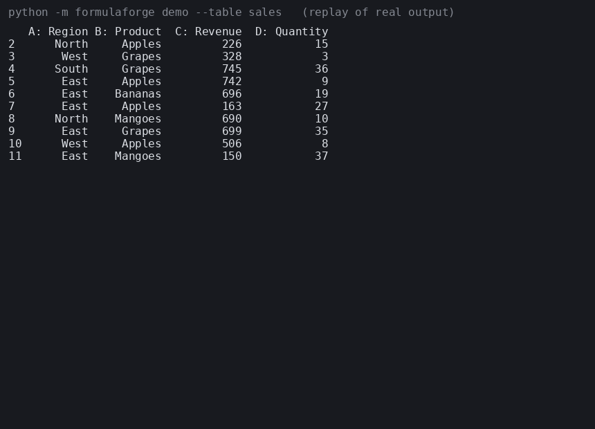

# FormulaForge: NL-to-Excel-Formula Transformer with Execution-Based Grading

Train a small transformer from scratch (or fine-tune T5-small) to turn plain-English spreadsheet
requests into Excel formulas, then grade every output by **executing it on sample tables** instead of
comparing strings.



*The GIF is a 30-second replay rendered from real CLI output (`scripts/make_demo_gif.py`), not a screen recording. It shows the first four
requests I tried on the `sales` table after picking that table: three correct, one wrong-column failure, which is shown on purpose.
Overall test accuracy is below.*

## Results

Held-out test set, 1,000 examples, execution graded on 3 fresh tables per example (default config, beam 4):

| Difficulty tier | N | Exact match | Execution accuracy |
|---|---|---|---|
| 1 (single function) | 264 | 88.6% | 89.8% |
| 2 (one condition / lookup) | 382 | 66.5% | 73.6% |
| 3 (multi-condition / nested) | 354 | 58.5% | 73.4% |
| **All** | **1000** | **69.5%** | **77.8%** |

String matching under-reports accuracy by 8.3 points: 83 predictions were correct when executed but differ textually from gold.

**Resume line:** *Trained a from-scratch transformer for NL-to-Excel-formula generation on a self-generated 41.5k-example synthetic dataset; execution-based grading measured 77.8% accuracy versus 69.5% under string matching.*

Technical report (dataset card, training details, evaluation-time ablations, limitations): [`docs/technical_report.md`](docs/technical_report.md).
Known limitation: the model learned a shortcut that a key column (names, customers) means "lookup", so it can wrongly emit `INDEX/MATCH` on tables that have one. See the report.

```
"Total Revenue where Region is East and Quantity is at least 20"
  + schema  A Region text; B Revenue number; C Quantity number; rows 2 to 11
  -> =SUMIFS(B2:B11,A2:A11,"East",C2:C11,">=20")   -> 4210
```

## Features

- **Synthetic data pipeline** (`formulaforge/templates.py`, `paraphrase.py`, `dataset.py`): 28 formula templates across
  8 function families (SUM, AVERAGE, MINMAX, COUNTIF, IF, SUMIFS, VLOOKUP, INDEX_MATCH), each with several
  NL phrasings, rule-based paraphrasing (synonym swaps, polite prefixes/suffixes, article dropping), random
  table schemas, dedup, and three **difficulty tiers**.
- **Seq2seq model** (`train.py`, `configs/*.yaml`): a T5 encoder-decoder trained from scratch with a word-level
  tokenizer (default, CPU friendly), or fine-tuned `t5-small` via `configs/pretrained.yaml`. Seeded, config driven,
  TensorBoard logging.
- **Execution-based evaluator** (`evaluator.py`): runs predicted and gold formulas with the
  [`formulas`](https://github.com/vinci1it2000/formulas) library on several freshly generated held-out tables and
  reports **execution accuracy next to exact match** and valid-formula rate.
- **Error analysis report** (`analysis.py`): Markdown + JSON with metrics by function family, by tier, a
  family x tier matrix, failure-mode buckets (invalid formula / wrong function / wrong reference / wrong literal /
  wrong operator) and example failures.
- **Demos**: interactive CLI (`python -m formulaforge demo`) and a Streamlit app (`app/streamlit_app.py`) showing the
  table, the generated formula and the computed result.

## Architecture

```
templates.py + paraphrase.py --> dataset.py --> data/{train,val,test}.jsonl
   (NL, formula, TableSpec)       dedup, split       one JSON record per example (no table values stored)
                                                          |
configs/*.yaml --> train.py (T5 + WordTokenizer/HFTokenizer) --> runs/<name>/model
                                                          |
             predict.py  (beam search)  ---> predicted formulas
                                                          |
tables.generate_table(spec, fresh seeds) --> evaluator.grade(pred, gold) --> analysis.py --> report_*.md / eval_*.json
```

An example stores the NL request, the gold formula, family, tier, and a **`TableSpec`** (column names/kinds, row count,
"value X must / must not appear" constraints). The evaluator regenerates tables from the spec with new seeds, so grading
never sees the table the model was trained next to.

## Setup

Python 3.10+ (developed on 3.14). CPU is enough; a GPU is used automatically if present.

```bash
python -m venv .venv && source .venv/bin/activate
pip install torch --index-url https://download.pytorch.org/whl/cpu   # CPU build (skip for GPU/default wheel)
pip install -r requirements.txt
cp .env.example .env     # optional: nothing in it is required
```

No API keys, services or downloads are needed for the default (from-scratch) path.

## Run

```bash
# 1. build the synthetic dataset (about 3 min, mostly gold-formula validation)
python -m formulaforge generate --config configs/scratch.yaml

# 2. train (about 45 min on 2 CPU cores; TensorBoard logs in runs/scratch/tb)
python -m formulaforge train --config configs/scratch.yaml

# 3. execution-based evaluation + error analysis -> runs/scratch/report_test.md
python -m formulaforge evaluate --config configs/scratch.yaml --split test

# 4. demos
python -m formulaforge demo --table employees --request "What is the Salary of Alice?"
python -m formulaforge demo --table sales            # interactive prompt
streamlit run app/streamlit_app.py
tensorboard --logdir runs/scratch/tb
```

A one-minute smoke run of the whole pipeline: use `configs/smoke.yaml` in steps 1-3 (the model it produces is untrained noise).
To fine-tune T5-small instead: `--config configs/pretrained.yaml` (downloads the checkpoint from the Hugging Face Hub once;
slow on CPU, and not run for the numbers below).

## Test

```bash
pytest
```

66 tests cover the evaluator (every function family, error handling, result comparison), table/ dataset generation
(determinism, dedup, split disjointness, every template's gold formula executing on many random tables),
tokenizer round-trips, failure classification, report generation, and an end-to-end generate -> train -> evaluate run.

## More results

Full breakdown by family, a family x tier matrix, failure modes and example failures: [`docs/sample_report_test.md`](docs/sample_report_test.md)
(regenerated under `runs/scratch/` by `evaluate`). Weakest family is SUMIFS (57.9% execution accuracy), strongest COUNTIF (92.7%); 85% of
failures are `wrong_reference` (valid formula, wrong column). Evaluation-time ablations (beams, number of held-out tables) are in the report;
training-side ablations were not run. Use `evaluate --beams N --tables K` to reproduce them.

Tiers describe template structure, not measured difficulty, so accuracy is not strictly monotone. Numbers vary a little between training runs
and hardware (single seed, about +-1.3 points standard error on 1,000 examples).

## Key design decisions

- **Execution accuracy is the headline metric.** `SUMIF(A:A,"East",B:B)` and `SUMIFS(B:B,A:A,"East")` are the same
  computation; exact match punishes the model for it. The data deliberately contains both spellings for single-criterion
  sums, so the gap between the two metrics is real, not cosmetic. Conversely, execution can only *agree* by accident if the
  held-out tables are uninformative, so each example is run on 3 fresh tables (all must agree) with random values, and tables
  are built with constraints: looked-up keys exist (or are guaranteed absent for the `IFERROR(... "Not found")` templates),
  and filter literals appear in the table.
- **Errors never match.** Parse errors, unknown functions, `#N/A`, `#DIV/0!` all evaluate to a sentinel that is never equal
  to anything, even another error. Gold formulas are validated at dataset-build time to be defined on every held-out table.
- **Tables are specs, not data.** Records are tiny, regenerable and the evaluator can draw as many held-out tables as it wants.
- **Schema in the prompt.** The encoder sees the request plus `A Region text; B Revenue number; ...; rows 2 to 11`. Formulas use
  absolute A1 ranges, so the model has to map column names to letters and copy the last row number.
- **Splits are disjoint on encoder input**, so no test request appears verbatim in training. They are *not* disjoint on
  template: the task measures generalisation to new schemas, values and phrasings of known formula shapes, not new formula shapes.
- **Tokenizer.** T5's sentencepiece vocab lacks `<` (needed for `<=`/`<>`), so the from-scratch model uses a small regex word/digit
  vocabulary built from the training data (digits are single tokens; spaces inside quoted strings are protected). The pretrained path
  escapes `<` reversibly.
- **"From scratch" means T5 architecture, random init.** A tiny decoder-only variant (optional in the spec) was not built; the
  encoder-decoder already covers the from-scratch requirement.
- **Model size is set by the hardware used to produce the results** (2 shared CPU cores, <4 GB RAM): ~1.2M parameters and ~45 min of
  training. A bigger model / longer schedule is a config change (`model.*`, `train.epochs`) and should improve every number below.
- **Paraphrasing is rule-based** (no LLM dependency, fully reproducible). It adds lexical diversity but not the open-ended variety
  of real user requests; expect degraded performance on phrasing far from the templates.
- **Evaluation limits.** Only single-sheet, single-table requests with exact-match lookups are covered; `formulas` is the evaluation
  engine, so the results inherit its Excel-compatibility quirks. W&B offline mode was not wired in; TensorBoard is used.

## Project layout

```
formulaforge/   tables, templates, paraphrase, dataset, tokenization, train, predict, evaluator, analysis, demo, cli
app/            Streamlit demo
configs/        scratch.yaml (default), pretrained.yaml (t5-small), smoke.yaml
tests/          pytest suite
docs/           technical report, sample error-analysis report, demo GIF
scripts/        make_demo_gif.py (renders docs/demo.gif from captured demo output)
```
